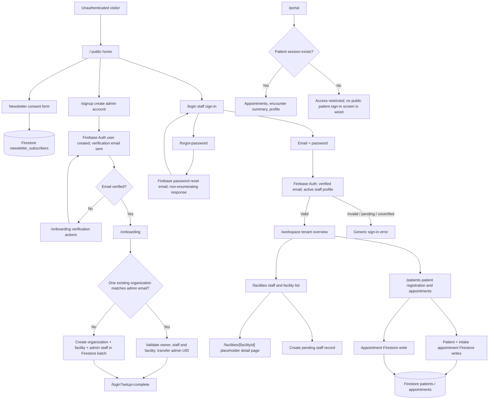
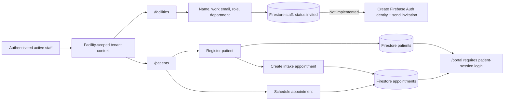
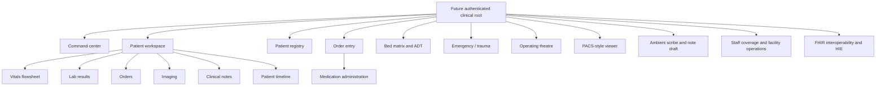
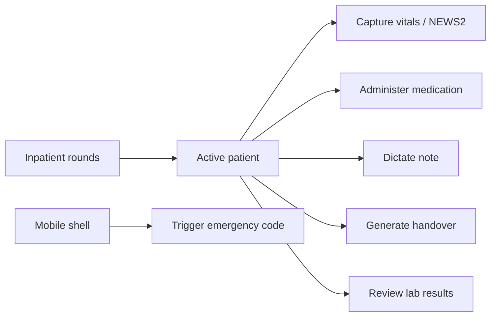
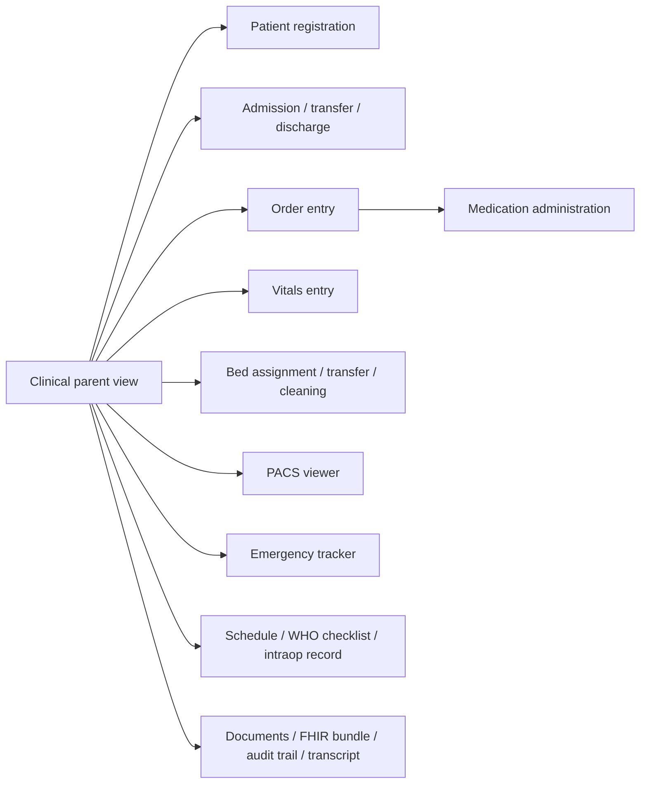

# BJI MediSupport Project Flows

This is an as-is map of the current repository plus the remaining integration path. It preserves work already present and separates reachable pages from clinical components that are not currently mounted. It is not a claim of production or regulatory readiness.

## 1. Current Route Map

## 2. Screen Inventory And Current State

| Route or screen | Current implementation | State / gap |
| --- | --- | --- |
| `/` | Public home, links to signup/login, newsletter form | Implemented; newsletter writes directly to Firestore and needs its own security/rate-limit review. |
| `/signup` | Firebase email/password account creation, email verification, live strength meter, confirmation | Implemented; strong-password policy is also enforced in Firebase Auth. |
| `/login` | Firebase sign-in by email/password; facility is resolved from the staff profile | Implemented; Firebase Auth must contain an active, verified staff account. |
| `/forgot-password` | Firebase reset email request with generic success copy | Implemented; delivery has not been tested with a real Auth account. |
| `/onboarding` | Email verification, existing-tenant recovery, or initial organization/facility/admin setup | Implemented in code; existing tenant details are reused on recovery. |
| `/workspace` | Authentication-gated organization/facility overview and context selection | Implemented, but it is not the clinical operations shell. |
| `/facilities` | Facility list and pending staff records | Partial: invitation record is stored, but Firebase Auth account creation and invitation delivery are not implemented. |
| `/facilities/[facilityId]` | Empty-state detail placeholder | Placeholder; no facility-specific dashboard yet. |
| `/patients` | Patient registration, intake appointment, appointment scheduling | Implemented; live operation requires an authenticated staff profile and matching Firestore rules. |
| `/portal` | Patient-facing appointment/profile view | Partial: portal requires an existing patient session, but no public patient sign-in screen is wired. |
| Desktop clinical shell | `AppShell` + `DesktopHospitalWorkspace` with command, chart, orders/CPOE, medications, pharmacy, beds, imaging, scribe, operations, theatre, registry, emergency, facility admin, FHIR | Rich components exist, but there are no imports/usages mounting them from current routes. Not reachable via `/workspace` today. |
| Mobile clinical shell | `MobileHospitalApp`: rounds, patient, vitals, eMAR, dictation, SBAR, labs | Component exists but is not mounted by a route. |

## 3. Staff And Patient Operations

## 4. Clinical Workspace Screens Already Present In Code

These are component-level views, not currently routable pages. The desktop navigation in `DesktopHospitalWorkspace` includes:

The mobile shell has a separate task flow:

## 5. Task Modals, Drawers, And Viewers

These are supporting screens inside their owning workflows; they are not separate URL routes. Clinical-shell items remain unreachable until the shell/provider wiring described below is completed.

| Parent workflow | Supporting screen(s) | Purpose |
| --- | --- | --- |
| Authentication / session | `UnifiedAuthModal`, `SessionLockModal`, `KeyboardShortcutsModal` | Authentication prompt, lock/unlock, shortcut reference. |
| Patient registry | `RegisterPatientModal` | Patient intake from a registry workflow. |
| Encounter / orders | `CpoeOrderModal`, `DoseAdministrationModal`, `AdtModal`, `VitalsEntryModal` | Enter orders, administer doses, admit/transfer/discharge, record vitals. |
| Bed operations | `BedAssignmentModal`, `BedTransferModal`, `EvsCleaningModal` | Assign/transfer beds and record EVS cleaning. |
| Imaging / records | `PacsStyleViewerModal`, `FhirBundleViewer`, `TranscriptViewer`, `DocumentGeneratorModal`, `AuditTrailDrawer` | Review imaging, exchange bundles, transcripts, generate documents, inspect audit history. |
| Emergency | `CodeBlueTrackerModal` | Track and resolve emergency response. |
| Surgery | `ScheduleCaseModal`, `WhoChecklistModal`, `IntraopRecordModal` | Schedule cases, run the WHO checklist, record intraoperative details. |
| Facility administration | `RegisterFacilityModal`, `RegisterStaffModal` | Facility and staff setup; current tenant flow only creates a pending staff record, not Auth credentials or an email invitation. |

## 6. Integration Roadmap

1. **Protect and complete identity:** create/verify the real administrator Auth account; decide whether to enable Identity Platform and enforce MFA; finish invitation provisioning so staff receive individual Auth accounts rather than shared PINs.
2. **Connect the tenant shell:** mount the clinical route behind an authenticated role gate; add `HospitalProvider` where required; reconcile `PlatformProvider`/Firestore records with `HospitalProvider` state before exposing clinical screens.
3. **Make navigation durable:** route or deep-link desktop views, retain selected facility/patient context, and implement a real facility-detail screen. The current “Add facility” action routes to onboarding, which currently recovers/creates a tenant rather than adding a second facility.
4. **Persist clinical records:** connect encounters, observations, medication orders/administrations, beds, imaging, notes, emergencies, surgical cases, and audit events to facility-scoped Firestore operations. Test every write against the deployed rules.
5. **Complete patient portal access:** implement a dedicated patient sign-in/identity verification and session flow; do not rely on a locally selected patient session for production records.
6. **Production gate:** verify least-privilege RBAC, MFA, audit retention, backups/restore, incident response, data retention, and legal/privacy controls before entering real PHI. Firebase use alone does not establish HIPAA compliance; confirm applicable contracts and configuration (including a BAA where required).

## 7. Architecture Notes

- `src/app/layout.tsx` currently mounts `SessionProvider` and `PlatformProvider` only.
- `HospitalProvider` exists in `src/lib/state/hospital-store.tsx`, but no current route mounts it; `useHospital` consumers in the clinical shells require that provider.
- `AppShell`, `DesktopHospitalWorkspace`, and `MobileHospitalApp` currently have no import/use sites.
- Firestore tenant access is facility-scoped. Pending staff documents do not by themselves create sign-in credentials.
- The secure signup/reset screens are available, but Auth currently has no users; test reset email delivery only after an administrator account exists.
